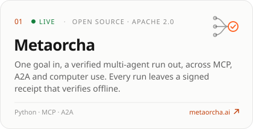
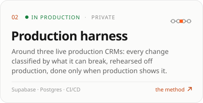
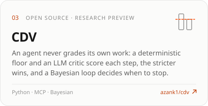
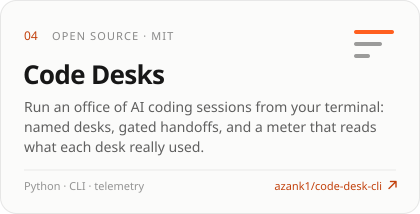
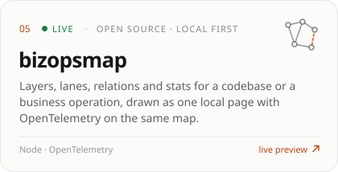
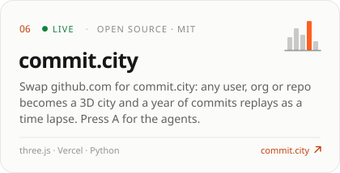

**Software engineer working on AI agents and the systems that check them.**
I turn research questions into working software: measurable, inspectable, and useful past the demo.

### Now

- **Production** · CRM DevOps and AI engineering at [Millennium Legal](https://www.millenniumlegal.co.uk/): the harness around three live production CRMs. [The method](https://azanhyder-port.vercel.app/research/#production)
- **Building** · [Metaorcha](https://metaorcha.ai), an open runtime where one goal becomes a verified multi-agent run. [Metabot](https://metaorcha.ai/metabot), the agent on top, is in progress.
- **Writing** · [The Harness Layer](https://dev.to/azankhyder/series/42904), field notes on agent harnesses, each with an artifact you can re-run.
- **Before** · Lead AI engineer at [Zayup](https://zayup.com/) (2023 to 2026), blockchain developer at AidTech, support engineering at [Trezor](https://trezor.io/).

### Work, most involved first

<a href="https://metaorcha.ai/"><picture><source media="(prefers-color-scheme: dark)" srcset="assets/cards/metaorcha-dark.svg"></picture></a>
<a href="https://azanhyder-port.vercel.app/research/#production"><picture><source media="(prefers-color-scheme: dark)" srcset="assets/cards/production-dark.svg"></picture></a>
<a href="https://github.com/azank1/cdv"><picture><source media="(prefers-color-scheme: dark)" srcset="assets/cards/cdv-dark.svg"></picture></a>
<a href="https://github.com/azank1/code-desk-cli"><picture><source media="(prefers-color-scheme: dark)" srcset="assets/cards/code-desks-dark.svg"></picture></a>
<a href="https://bizopsmap-preview-nu.vercel.app/"><picture><source media="(prefers-color-scheme: dark)" srcset="assets/cards/bizopsmap-dark.svg"></picture></a>
<a href="https://commit.city"><picture><source media="(prefers-color-scheme: dark)" srcset="assets/cards/commit-city-dark.svg"></picture></a>

Code behind the live ones: [metaorcha](https://github.com/solvent-labs-org/metaorcha) · [bizopsmap](https://github.com/azank1/bizopsmap) · [commit-city](https://github.com/azank1/commit-city) 
More: [RP2A](https://github.com/azank1/restaurant-provider-to-agent) · [ML Trend Probability](https://github.com/azank1/ML-ProbabalisticTrend) · [sdca-raqqr](https://github.com/azank1/sdca-raqqr) · [strategy-builder-ai](https://github.com/azank1/strategy-builder-ai) · [notion-mcp](https://github.com/azank1/notion-mcp) · [claude-agent](https://github.com/azank1/claude-agent) · [all 16 builds](https://azanhyder-port.vercel.app/catalog/)

### Measured

- **5/5** multi-protocol runs verified live, best wall clock 13 s · [Metaorcha](https://github.com/solvent-labs-org/metaorcha)
- **41%** fewer agent steps than a fixed budget, replicated to the digit, along with the case that breaks it · [field note 009](https://dev.to/azankhyder/a-stop-rule-that-trusts-one-score-is-worse-than-a-dumb-budget-428c)
- **5.4B** tokens metered over 30 days and 31k turns, 97% of them from cache · [Code Desks](https://github.com/azank1/code-desk-cli)
- **25** typed MCP tools behind a production voice-ordering agent · [RP2A](https://github.com/azank1/restaurant-provider-to-agent)
- **290+** tests under a multi-tenant restaurant OS, built by a five-person team I led · Zayup
- **3 weeks** to a complete React Native MVP, directing a three-developer team · DeliveryOS

### Writing

[The Harness Layer](https://dev.to/azankhyder/series/42904): field notes on agent harnesses, each with sources, its limits and an artifact you can re-run.

- [When should an agent stop?](https://dev.to/azankhyder/a-stop-rule-that-trusts-one-score-is-worse-than-a-dumb-budget-428c) · Sep 2026 · [artifact](https://github.com/azank1/code-desk-cli/tree/main/research/009-stop-rule)
- [Web chat is not a coding environment](https://dev.to/azankhyder/web-chat-is-not-a-coding-environment-2m77) · Sep 2026
- [Pacing the frontier does not watch the agents](https://dev.to/azankhyder/pacing-the-frontier-does-not-watch-the-agents-4i5o) · Sep 2026
- [Models converged. Trust hasn't.](https://dev.to/azankhyder/models-converged-trust-hasnt-1k53) · Aug 2026
- [I turned GitHub into a 3D city, then pressed A and saw who is really writing the code](https://dev.to/azankhyder/i-turned-github-into-a-3d-city-then-pressed-a-and-saw-who-is-really-writing-the-code-4jn2) · launch post, Oct 2026

### Stack

- **Agents** · MCP, A2A, computer use, LangGraph, LLM evaluation, Claude Code, Codex, Cursor
- **Production** · FastAPI, Next.js, Postgres, Supabase, pgvector, Redis, Vercel, Cloudflare Workers
- **Stats** · OpenTelemetry, Bayesian optimization, backtesting, KMeans and PCA
- **Languages** · Python, TypeScript, SQL, Bash, Solidity

### Activity

<a href="https://github.com/azank1">
  <picture>
    <source media="(prefers-color-scheme: dark)" srcset="https://streak-stats.demolab.com?user=azank1&border_radius=16&border=2f2f2f&background=181818&stroke=2f2f2f&ring=ff5f1f&fire=ff5f1f&currStreakLabel=ff8a50&currStreakNum=e4e4e4&sideNums=e4e4e4&sideLabels=a3a3a3&dates=737373">
    
  </picture>
</a>

### On carving your own path

**Side quests used to be what you did after work. I made them the work, and made it respectable.**

The method was simple: doubt every source except my own judgment, then keep retraining how I decide
things, scoring each move by how much it widened my exposure to lucky breaks. Run that loop long enough
and your choices converge on the handful that actually pay off, while a small share of every attempt
still goes to wandering on purpose.

Where it led: companies with nobody on payroll, built one day at a time as my way out of a class that
was never meant to move.

If you want a path that's genuinely yours, my one piece of advice is to defend your mind like it's
production. Trends flip. Focus erodes. Someone will always be trying to slip their narrative past your
filters and edit your worldview for you. Don't accept the patch.

**Outlast the noise and you win.**

---

Working on agent runtimes, protocol bridges or verification? [Open an issue on Metaorcha](https://github.com/solvent-labs-org/metaorcha/issues) or [email me](mailto:azanhyder49@gmail.com).

[azanhyder-port.vercel.app](https://azanhyder-port.vercel.app) · [metaorcha.ai](https://metaorcha.ai) · [dev.to](https://dev.to/azankhyder) · [X](https://x.com/azankhyder) · [LinkedIn](https://www.linkedin.com/in/azan-hyder-8aa58b408/) · [azanhyder49@gmail.com](mailto:azanhyder49@gmail.com) · *It's all relative.*
